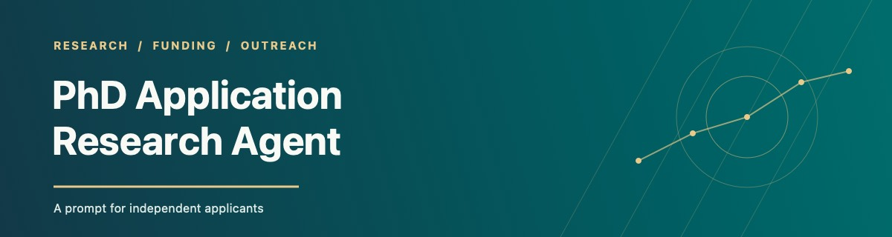
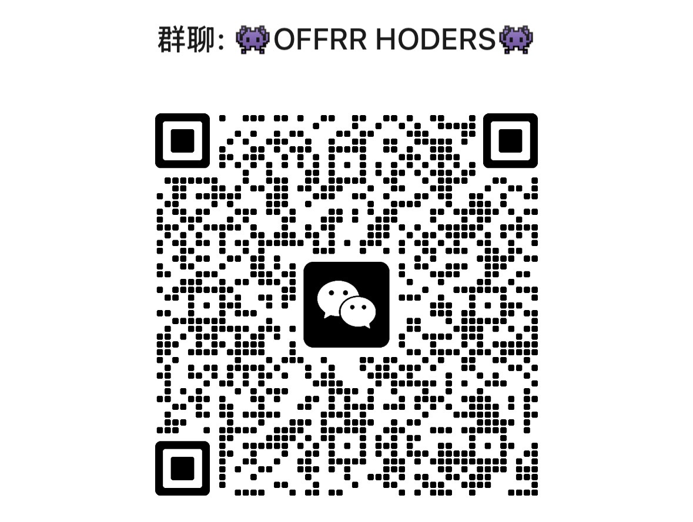

  

<h1 align="center">🎓 PhD Application Research Agent</h1>

<strong>Skip the bullshit admissions middlemen. Apply for a PhD with AI.</strong>

  <a href="README.md">简体中文</a> · <a href="docs/README.zh-TW.md">繁體中文</a> · <strong>English</strong> · <a href="docs/README.ja.md">日本語</a> · <a href="docs/README.ko.md">한국어</a> · <a href="docs/README.es.md">Español</a> · <a href="docs/README.fr.md">Français</a> · <a href="docs/README.pt.md">Português</a> · <a href="docs/README.de.md">Deutsch</a>

  <a href="prompts/PROMPT.en.md">Full prompt</a> · <a href="#-model-and-platform-setup">Model setup</a>

An open-source prompt for researching PhD supervisors, checking programmes and funding, drafting outreach emails, and tracking applications.

Spend around **15 minutes a day** reviewing research, email drafts and next actions. Initial setup, reading, writing proposals and submitting applications can take longer.

For the complete daily automated workflow, your AI platform must support **scheduled automation and email integration**: it must be able to work on a schedule and connect to an email account to read, draft and send messages. You approve each message before it is sent. Web research, file reading and persistent application records must also be available.

## 💌 To everyone applying for a PhD

> Before you begin your PhD applications, ask yourself: is doing a PhD truly what you want? Whatever you do, take the time to ask yourself whether it is really your own choice.
>
> When you apply by yourself instead of through an agency, the moment you receive an offer will be incredibly joyful. As time moves forward, moments of sheer joy become fewer, so try to make your joy even more joyful.
>
> An agency is helping you do something you are already capable of doing yourself. You are already amazing. You can do this!
>
> — Yi Fan

## 🧭 Our approach

A complete workflow connects research, verification, outreach and applications. Models keep improving, so we trust their writing ability instead of imposing a fixed template or word count. Your research, preferences and judgment guide the result.

- **When to apply:** At onboarding, the agent suggests 8–10 valid A/B replies from distinct supervisors as a reference for considering a shift from new outreach to applications. You can adjust it; urgent deadlines do not wait.
- **Direct applications count as options:** The agent investigates programmes that do not require prior supervisor agreement and asks whether you want to include them as A-DIRECT or B-DIRECT. These are counted separately from supervisor replies.
- **Deadlines every day:** Mail checks also show application and funding deadlines, remaining time and how long each target has if you start preparing applications today.

## ☁️ Recommended: run in the cloud

**We strongly recommend ChatGPT Work for this workflow**, whether on desktop, web or mobile. Desktop can also start cloud Work. If a daily 10:00 task needs to run while your computer is off, verify that the scheduled task and all required files and tools are accessible in the cloud.

Steps relying on local files or desktop apps may be unavailable when your computer is off or asleep. Local Codex also depends on the computer; Codex Cloud is another cloud option. Whichever you choose, verify scheduling, web access, email and application records. You still approve each email before sending.

Check file access especially: scheduled tasks created in a ChatGPT project cannot directly access files uploaded to or stored in that project. Place records where the task can actually access them and test. Set the time zone, run a real test and check the next run and report. Features vary by account, plan and workspace.

For example, try an authorized cloud file or connected service for the ledger if supported, and test that the scheduled task can both read and update the same record.

Official guidance: [ChatGPT Work and Codex](https://help.openai.com/en/articles/20001275/) · [Scheduled tasks in ChatGPT](https://help.openai.com/en/articles/10291617-scheduled-tasks-in-chatgpt) · [Codex Cloud](https://help.openai.com/en/articles/20001545-using-codex-cloud)

## ✨ What it covers

- Research supervisors and show concrete evidence of fit.
- Check programmes, eligibility, deadlines and funding against official sources.
- Draft individual outreach emails for your review.
- Track opportunities, conversations, materials and next steps.

The complete prompt contains 30 stages, from onboarding through research, outreach and application preparation.

## 🚀 Get started

1. Choose an AI platform and an available model.
2. Copy the entire [English prompt](prompts/PROMPT.en.md) into a new conversation or project.
3. Share your research interests, preferred regions, intended start year, funding requirements and CV. You can provide these gradually.
4. Authorize and verify scheduling and email access. Once set up, the AI delivers a daily report on schedule; review it, approve any emails and decide what happens next.

A scheduled task runs and delivers its daily report on schedule; enable ChatGPT push or email notifications if you want alerts. The report should include progress and deadlines even when there are no new replies. Without automation, start it manually.

## ⚙ Model and platform setup

Use ChatGPT, Claude, Gemini, Kimi, DeepSeek or another tool that can handle a long prompt. Choose the model in your platform; the prompt cannot change it for you. If available, enable web research and file reading. For complete automation, verify scheduled runs and email reading, drafting and sending on your specific platform and account; configure and authorize them before use.

Capabilities, limits and costs depend on the service. Without scheduling or email access, you can still use the prompt, but those steps must be done manually. Without web access, provide sources for the AI to organize and verify the important details yourself.

Review outreach before sending. Your research questions, applications and final decisions remain yours.

## 🤝 Contribute

Open an [issue](https://github.com/fanyi3017-stack/phd-application-research-agent/issues) or pull request. See [CONTRIBUTING.md](CONTRIBUTING.md).

Translations are AI-assisted; key rules have been checked. If meanings differ, refer to the simplified Chinese original. Corrections are welcome.

## 💬 Scope and community

This project focuses on supervisor research and outreach. If your conversations go well, a supervisor may be willing to advise on your research proposal and later applications, including scholarships; support depends on their actual response. If you are unsure about something, join our WeChat community to discuss it with fellow applicants. Contact and group access: [yifan@curatingmyatery.com](mailto:yifan@curatingmyatery.com).

**Scan to join the WeChat group “OFFRR HODERS”:**

If the code expires, contact us at the email above.

## 🙏 Acknowledgements

Thanks to [OpenAI](https://github.com/openai) and [Google](https://github.com/google) for their AI tools and technology; to everyone contributing code, documentation, plugins and troubleshooting; and to community members sharing feedback and results. [护谜（上海）智能科技有限公司](https://github.com/curatingmysteryshanghai) contributed Codex development compute.

## 📄 License

[MIT License](LICENSE) · Yi Fan

Copyright © 2026 护谜（上海）智能科技有限公司

